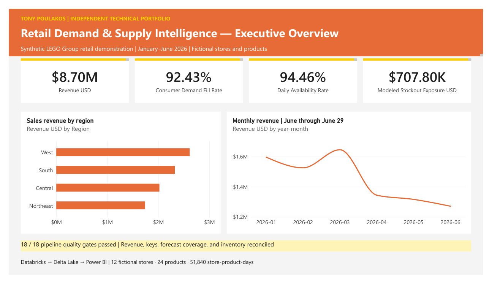
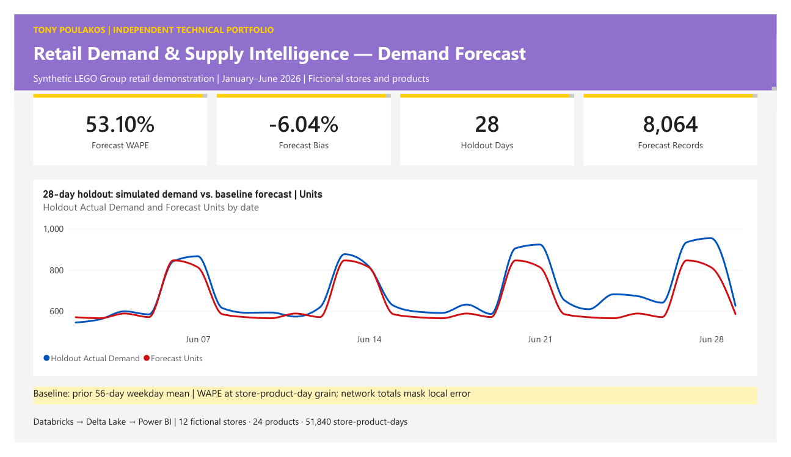
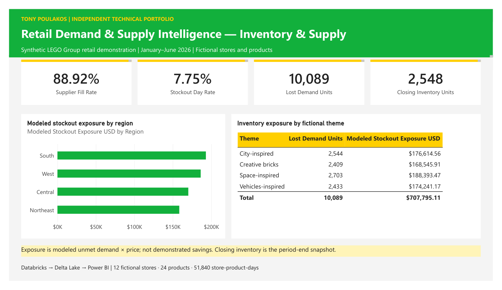

# LEGO Group Retail Demand & Supply Intelligence

**Tony Poulakos | Independent BI and data engineering portfolio**

An executed Databricks demonstration that turns realistic synthetic retail transactions, inventory, and replenishment data into a Power BI reporting model. It connects data engineering decisions to sales performance, demand forecasting, and inventory availability.

> Independent, LEGO Group-inspired technical demonstration. All stores, products, demand, transactions, and supply data are synthetic. This is not an official LEGO Group project, internal system, or enterprise production deployment.

[Read the five-page case study](reports/LEGO_Group_Retail_Case_Study.pdf) · [Open the notebook](notebooks/LEGO_Retail_Demand_Supply_Intelligence.ipynb) · [Download the Power BI file](powerbi/LEGO_Retail.pbix) · [View execution evidence](results/runtime_results.json)

## Business questions

- Where does sales performance vary across the fictional store network?
- How much simulated consumer demand is fulfilled, and where is inventory constrained?
- How accurately does a transparent weekday baseline forecast demand?
- How do partial supplier shipments affect replenishment fill rate?

## Scope and verified results

The synthetic dataset covers **12 stores, 24 products, and 180 days (January 1–June 29, 2026)**, producing **51,840 store-product-day observations**. Results below come from the exported successful Databricks run, not illustrative dashboard placeholders.

| Metric | Result | Interpretation |
|---|---:|---|
| Sales revenue | $8,701,703.34 | Simulated sales at synthetic daily prices |
| Units sold | 123,166 | Fulfilled consumer demand |
| Consumer demand fill rate | 92.43% | Sales units / simulated demand units |
| Daily availability | 94.46% | Share of rows with opening inventory + receipts > 0 |
| Stockout day rate | 7.75% | Share of rows with unmet demand |
| Lost demand units | 10,089 | Simulated demand less units sold |
| Modeled stockout exposure | $707,795.11 | Unmet demand × daily price; not realized savings |
| Supplier fill rate | 88.92% | Shipped / requested units, by order date |
| Closing inventory | 2,548 units | Last-date inventory snapshot |
| Forecast WAPE | 53.10% | Sum absolute error / sum demand at store-product-day grain |
| Forecast bias | −6.04% | Sum(forecast − demand) / sum demand |
| Data-quality checks | 18 / 18 passed | Exported pipeline validation evidence |

## Engineering implementation

**Python simulation → Bronze Delta → PySpark Silver validation → SQL Gold model and marts → Power BI snapshot import**

- Deterministic synthetic generation, including weekday effects, promotions, stochastic demand, replenishment lead times, and partial shipments.
- Bronze preserves raw deliveries, including five deliberate duplicate sales rows and three deliberately invalid rows.
- Silver deduplicates deliveries, quarantines invalid records, and validates business keys and inventory arithmetic.
- Gold provides three dimensions, three facts, and four reporting marts.
- Quality gates check row counts, foreign keys, duplicates, demand bounds, inventory conservation, forecast coverage, and revenue reconciliation.
- Delta audit tables and exported JSON/CSV record the run outcome.

The notebook contains Python, PySpark, and SQL. Delta tables live in the dedicated `lego_portfolio_demo` schema. Re-running replaces the demonstration's named tables and exports; this is a full-refresh prototype, not a scheduled production service.

## Power BI report

Five editable pages cover project summary, engineering evidence, executive overview, demand forecast, and inventory & supply. The model uses Date, Store, and Product dimensions with single-direction one-to-many relationships to the three fact tables. Replenishment uses order date for the active date relationship.

[Power BI Desktop file](powerbi/LEGO_Retail.pbix) · [Editable project](powerbi/LEGO_Retail.pbip)

The PBIX is the simplest opening option. Download it from GitHub before opening it in Power BI Desktop. Keep the PBIP alongside its Report and SemanticModel folders when using the project source. The included report uses embedded synthetic snapshot data; it is not connected live to Databricks.

The forecast is a fixed-origin, 28-day holdout using the preceding 56-day mean by store, product, and weekday. Its 53.10% Weighted Absolute Percentage Error (WAPE) is a baseline result with substantial local error. Aggregated network curves can appear closer than the store-product-day error suggests. Simulated unconstrained demand is available here; real retail demand lost to stockouts would need estimation.

## Explore or reproduce

1. Start with the [PDF](reports/LEGO_Group_Retail_Case_Study.pdf) and dashboard previews.
2. Inspect [exported results](results/runtime_results.json) and [quality checks](results/quality_checks.csv).
3. Follow the [reproduction guide](docs/REPRODUCTION.md) to run the Databricks notebook.
4. Review the [data dictionary](docs/DATA_DICTIONARY.md) for table grains and KPI definitions.

The notebook source is supplied separately from its executed output evidence. The exported audit files document one successful run; they do not establish production reliability. The recorded 124.69 seconds is elapsed time to KPI capture for that run, not a performance benchmark.

## Repository contents

| Folder | Contents |
|---|---|
| `notebooks/` | Importable Databricks notebook and Python source export |
| `data/gold/` | Six reporting model CSV tables |
| `data/marts/` | Four aggregated reporting marts |
| `results/` | Runtime metrics and 18 quality-check outcomes |
| `powerbi/` | Supplied PBIX, editable PBIP project, and theme |
| `reports/` | Final five-page case study PDF |
| `images/` | Previews rendered from the supplied final PDF |
| `docs/` | Reproduction instructions, definitions, and validation notes |

## Limitations and next engineering steps

The demonstration uses synthetic demand, a simple baseline, full refresh, and snapshot reporting. Incremental ingestion, orchestration, access controls, operational monitoring, recovery testing, and improved forecast evaluation would be future work. No realized revenue uplift, cost savings, or production deployment is claimed.

## Attribution and rights

© 2026 Tony Poulakos. All rights reserved. Published for professional portfolio review. No open-source license is granted. Company names and trademarks belong to their respective owners. Their use does not imply affiliation, endorsement, or sponsorship.
